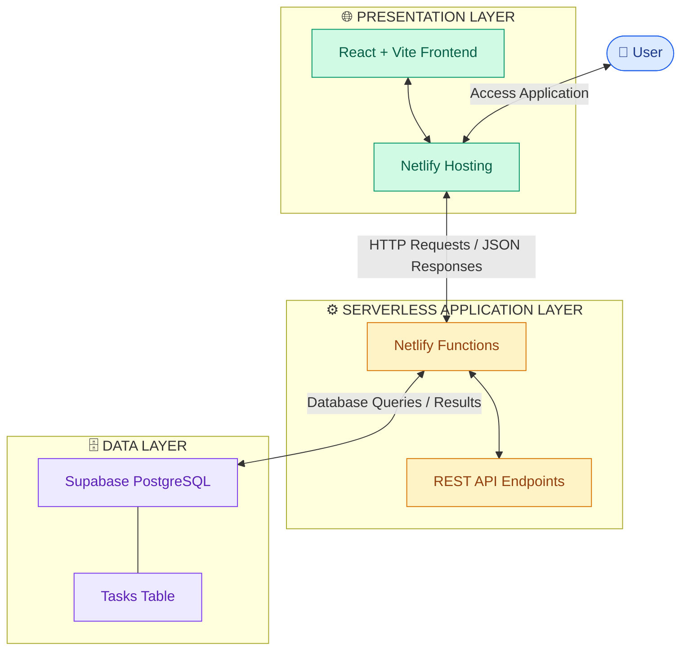

# ☁️ CloudTasks — Cloud-Based Task Management Platform

<p align="center">
  
  
  
  
</p>

<p align="center">
  <strong>A modern, cloud-powered task management platform designed to organize, track, and manage tasks efficiently.</strong>
</p>

<p align="center">
  <a href="#-overview">Overview</a> •
  <a href="#-features">Features</a> •
  <a href="#-architecture">Architecture</a> •
  <a href="#-technology-stack">Tech Stack</a> •
  <a href="#-installation-and-setup">Installation</a> •
  <a href="#-api-endpoints">API</a>
</p>

---

## 🌐 Live Demo

**Live Application:** [cloud-task-management-platform.netlify.app/](cloud-task-management-platform.netlify.app/)

**GitHub Repository:** [https://github.com/info-ashenrsh/cloud-task-management-platform](https://github.com/info-ashenrsh/cloud-task-management-platform)

---

## 📌 Overview

**CloudTasks** is a cloud-based task management application built to simplify everyday task organization and productivity.

The platform allows users to create, view, update, and delete tasks through a modern web interface. It uses a cloud-hosted PostgreSQL database to persist task information and a serverless API architecture to connect the frontend with the database.

The project demonstrates the practical implementation of modern web development, cloud database integration, serverless computing, and automated deployment workflows.

## ✨ Features

### 📋 Task Management
- Create new tasks.
- View all existing tasks.
- Update task information.
- Delete tasks.
- Store task descriptions and details.

### 🎯 Task Organization
- Manage task status:
  - Pending
  - In Progress
  - Completed
- Assign task priorities:
  - Low
  - Medium
  - High

### ☁️ Cloud Integration
- Cloud-hosted PostgreSQL database powered by Supabase.
- Serverless API powered by Netlify Functions.
- Frontend hosting and deployment through Netlify.
- Persistent task storage.

### 🚀 Modern Web Architecture
- React-based frontend.
- Node.js and Express backend for local development.
- REST-style API operations.
- GitHub-based source control and deployment integration.

## 🖥️ Technology Stack

| Category | Technology |
|---|---|
| Frontend | React.js |
| Build Tool | Vite |
| Backend | Node.js |
| Backend Framework | Express.js |
| Serverless API | Netlify Functions |
| Database | Supabase PostgreSQL |
| Database Client | Supabase JavaScript Client |
| Deployment | Netlify |
| Version Control | Git & GitHub |
| Development Environment | GitHub Codespaces |

## 🏗️ System Architecture

CloudTasks follows a **serverless cloud architecture** that integrates a modern React frontend, Netlify Functions, and Supabase PostgreSQL to provide a scalable and efficient task management experience.

### Architecture Diagram



### 🔄 Request and Data Flow

1. **User Interaction:** Users access the CloudTasks application through a web browser.
2. **Frontend Layer:** React and Vite provide the user interface, hosted on Netlify.
3. **API Communication:** The frontend sends HTTP requests to the Netlify Functions API.
4. **Serverless Processing:** Netlify Functions handle task operations, including creating, retrieving, updating, and deleting tasks.
5. **Database Integration:** The API communicates with Supabase PostgreSQL to store and retrieve task information.
6. **Response Delivery:** The API returns JSON responses to the frontend, which updates the interface.

### 🧩 Architecture Components

| Layer | Technology | Responsibility |
|---|---|---|
| Presentation | React + Vite | User interface and interactions |
| Hosting | Netlify | Frontend deployment |
| Application | Netlify Functions | Serverless API processing |
| Database | Supabase PostgreSQL | Persistent task storage |
| Version Control | GitHub | Source code management |

**Architecture Highlights:** Serverless API processing, cloud-hosted database, REST-based communication, and automated GitHub-to-Netlify deployment.

### Application Workflow

1. Users interact with the React frontend.
2. The frontend sends HTTP requests to the API.
3. Netlify Functions process the incoming requests.
4. The API communicates with Supabase PostgreSQL.
5. Database results are returned to the frontend.
6. The interface displays the updated task information.

## 📁 Project Structure

```text
cloud-task-management-platform/
│
├── backend/
│   ├── config/
│   │   └── db.js
│   ├── routes/
│   │   └── taskRoutes.js
│   ├── server.js
│   └── .env
│
├── frontend/
│   ├── src/
│   │   ├── services/
│   │   │   └── api.js
│   │   ├── components/
│   │   └── ...
│   ├── public/
│   └── package.json
│
├── netlify/
│   └── functions/
│       └── tasks.mjs
│
├── netlify.toml
├── package.json
├── package-lock.json
└── README.md
```

## ⚙️ Installation and Setup

Follow these steps to run CloudTasks locally.

### 1. Clone the Repository

```bash
git clone https://github.com/info-ashenrsh/cloud-task-management-platform.git
```

```bash
cd cloud-task-management-platform
```

### 2. Install Frontend Dependencies

```bash
cd frontend
npm install
```

### 3. Configure Environment Variables

For the local Express backend, create a `.env` file inside the `backend` directory.

```env
PORT=5000
DATABASE_URL=your_postgresql_connection_string
DB_SSL=true
```

For local frontend development, configure `VITE_API_URL` in the frontend environment file to point to your local backend:

```env
VITE_API_URL=http://localhost:5000
```

**Important:** Never commit `.env` files or expose database credentials and secret API keys in your GitHub repository.

### 4. Start the Backend

From the project root:

```bash
cd backend
npm install
npm run dev
```

The backend should be available at:

```text
http://localhost:5000
```

### 5. Start the Frontend

Open another terminal:

```bash
cd frontend
npm run dev
```

Open the local development URL displayed by Vite in your browser.

## 🗄️ Database Configuration

CloudTasks uses Supabase PostgreSQL for cloud-based task storage.

Create a Supabase project and execute the following SQL in the Supabase SQL Editor:

```sql
CREATE TABLE IF NOT EXISTS public.tasks (
    id BIGINT GENERATED BY DEFAULT AS IDENTITY PRIMARY KEY,
    title VARCHAR(255) NOT NULL,
    description TEXT DEFAULT '',
    status VARCHAR(20) NOT NULL DEFAULT 'Pending'
        CHECK (status IN ('Pending', 'In Progress', 'Completed')),
    priority VARCHAR(10) NOT NULL DEFAULT 'Medium'
        CHECK (priority IN ('Low', 'Medium', 'High')),
    created_at TIMESTAMPTZ NOT NULL DEFAULT NOW()
);
```

### Netlify Environment Variables

Configure the following variables in your Netlify project:

| Variable | Description |
|---|---|
| `SUPABASE_URL` | Your Supabase project URL |
| `SUPABASE_SECRET_KEY` | Your server-side Supabase secret key |

Keep the secret key exclusively on the server side. Never expose it through frontend environment variables or commit it to GitHub.

## 🔌 API Endpoints

The deployed application uses the following task API endpoints:

| Method | Endpoint | Description |
|---|---|---|
| GET | `/api/tasks` | Retrieve all tasks |
| GET | `/api/tasks/:id` | Retrieve a specific task |
| POST | `/api/tasks` | Create a new task |
| PUT | `/api/tasks/:id` | Update an existing task |
| DELETE | `/api/tasks/:id` | Delete a task |

### Example: Create a Task

**Request:**

```http
POST /api/tasks
Content-Type: application/json
```

**Request Body:**

```json
{
  "title": "Complete CloudTasks Project",
  "description": "Finish cloud deployment and testing.",
  "status": "Pending",
  "priority": "High"
}
```

## 🚀 Deployment

CloudTasks is designed around a cloud deployment architecture using Netlify and Supabase.

### Deployment Components

| Component | Platform |
|---|---|
| Frontend Hosting | Netlify |
| Serverless Backend API | Netlify Functions |
| Cloud Database | Supabase |
| Source Code Repository | GitHub |

### Deployment Workflow

1. Push project changes to the GitHub repository.
2. Connect the repository to Netlify.
3. Configure the build settings.
4. Add the required Supabase environment variables.
5. Deploy the frontend and serverless functions.
6. Verify the application and database connectivity.

### Netlify Build Configuration

The project uses `netlify.toml`:

```toml
[build]
  command = "npm --prefix frontend install && npm --prefix frontend run build"
  publish = "frontend/dist"

[functions]
  directory = "netlify/functions"

[[redirects]]
  from = "/api/tasks/*"
  to = "/.netlify/functions/tasks/:splat"
  status = 200

[[redirects]]
  from = "/api/tasks"
  to = "/.netlify/functions/tasks"
  status = 200

[[redirects]]
  from = "/*"
  to = "/index.html"
  status = 200
```

## 🔒 Security Considerations

- Keep Supabase secret keys on the server side.
- Never upload environment files containing credentials.
- Configure database permissions and Row Level Security policies appropriately.
- Validate API request data before database operations.
- Consider implementing user authentication and authorization before using the application for private or sensitive tasks.

## 🎯 Project Objectives

This project provides practical experience in:

- Full-stack web application development.
- REST API development and integration.
- PostgreSQL database management.
- Cloud database connectivity.
- Serverless application architecture.
- Cloud deployment using Netlify.
- Environment variable management.
- Git and GitHub version control.

## 🔮 Future Improvements

Potential enhancements include:

- [ ] User registration and authentication.
- [ ] User-specific task management.
- [ ] Task search and filtering.
- [ ] Due dates and reminders.
- [ ] Task analytics and dashboard statistics.
- [ ] Team collaboration.
- [ ] Automated testing and CI/CD workflows.
- [ ] Improved monitoring and error logging.

## 👨‍💻 Author

**Ashen Rashmika**

Undergraduate | Software Development | Cloud Technologies | DevOps

- GitHub: [@info-ashenrsh](https://github.com/info-ashenrsh)
- Project: [CloudTasks](https://github.com/info-ashenrsh/cloud-task-management-platform)

---

## ⭐ Support

If you find this project interesting or useful, consider giving the repository a **Star ⭐** on GitHub.

Your support and feedback are appreciated!

<p align="center">
  <strong>Built with ❤️ using modern web and cloud technologies.</strong>
</p>
